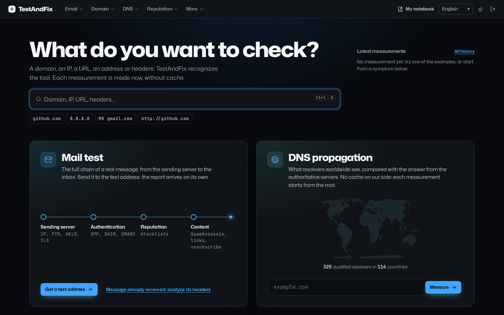
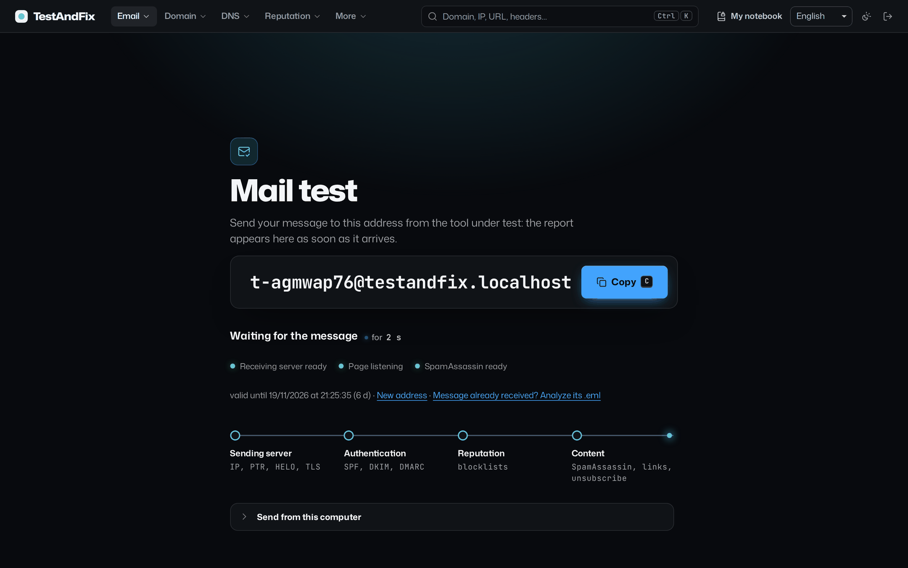
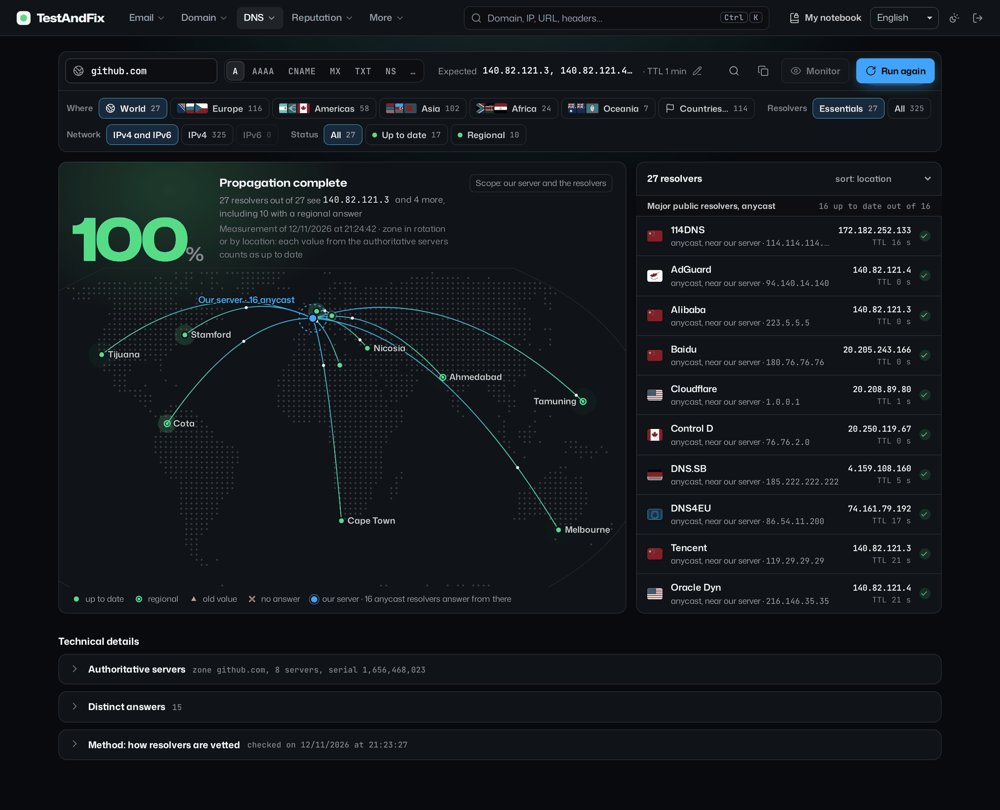
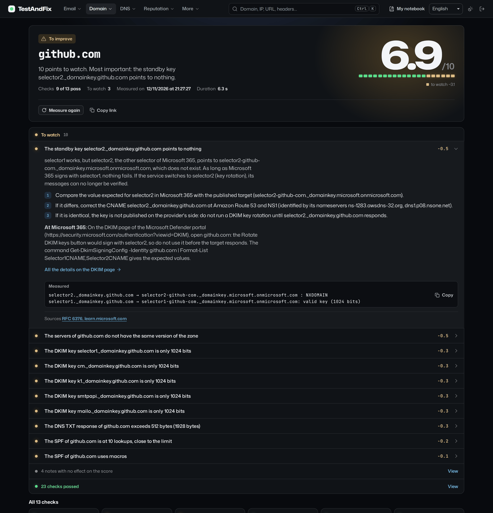
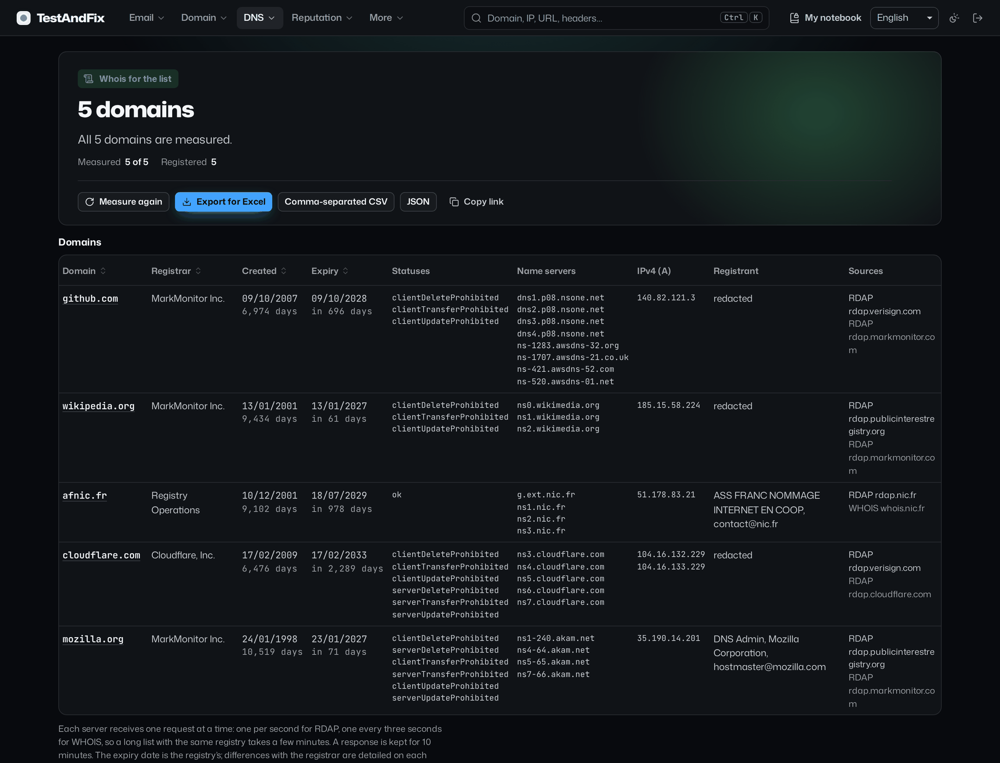
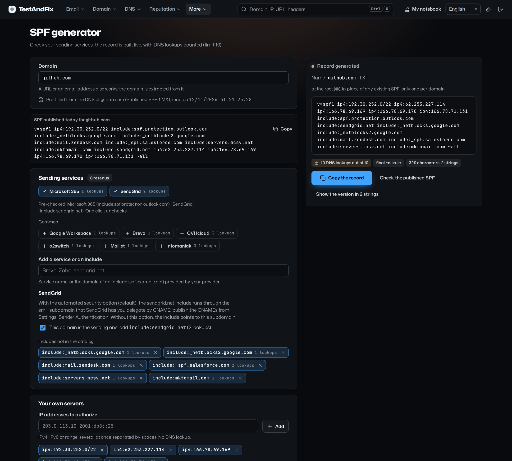
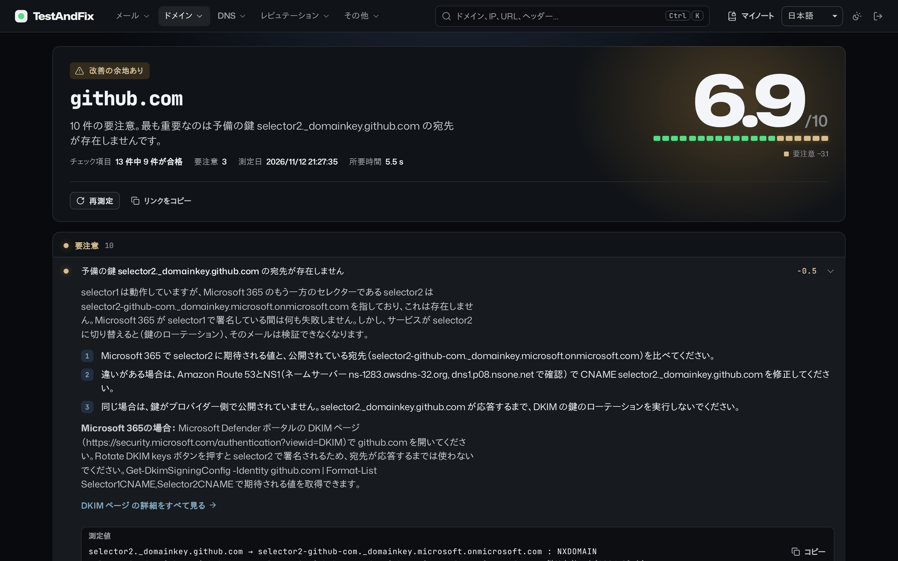
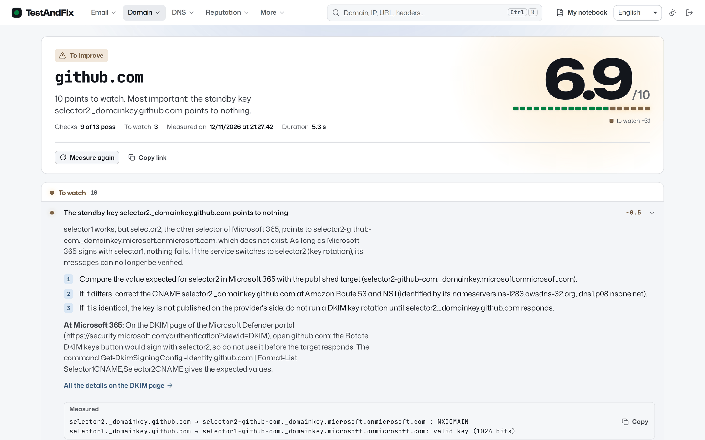

<div align="center">

# TestAndFix

**Testez vos mails et votre DNS comme avec les meilleurs outils en ligne, puis obtenez la correction exacte. Sur votre propre serveur.**

Test de mail · Propagation DNS · Scanner de domaine · Whois et RDAP · Réputation · Générateurs · Rapports DMARC

Auto-hébergé · licence MIT · Docker Compose · 6 langues · sans compte, sans quota

[English](README.md) · Français



</div>

## Pourquoi un outil de plus ?

Les outils en ligne disent **qu'il** y a un problème. TestAndFix dit **pourquoi**, **ce qu'il vous coûte** et
**quoi coller où** pour le corriger, chez votre outil d'envoi.

- **Une note n'est pas une correction.** Chaque constat vient d'une base de **949 situations diagnostiquées**,
  chacune avec la raison en mots simples, la correction prête à copier, et les étapes pour **24 services
  d'envoi et hébergeurs** (Google Workspace, Microsoft 365, Brevo, Mailchimp, SendGrid, Amazon SES, Mailjet,
  Postmark, OVHcloud, cPanel, WordPress…). **528 règles SpamAssassin** sont expliquées par leur nom, avec
  **1 461 références** aux RFC et aux documentations des fournisseurs.
- **La note mesure la livraison.** La note d'un test de mail reflète ce qui décide de l'arrivée de ce message
  en boîte de réception ; les conseils de bonne pratique sont listés à part et ne coûtent aucun point : un message
  réparé obtient de 9 à 10.
- **Vos tests restent à vous.** Pas de quota quotidien, pas de page de résultat publique accessible à
  quiconque devine une adresse. Les résultats appartiennent au navigateur qui les a lancés ; un rapport ne se
  partage que si vous créez un lien.
- **Mesuré en direct, à la source.** Les réponses DNS sont résolues depuis la racine, sans cache, et
  comparées aux serveurs qui font autorité. Les résolveurs de la propagation sont requalifiés chaque jour.
- **Dans votre langue.** Anglais, espagnol, allemand, japonais, français et portugais, détectés depuis le
  navigateur : l'interface, et chaque diagnostic et chaque correction écrits par le serveur.

## Les outils

### Test de mail : envoyez un vrai message, obtenez toute la chaîne



Créez une adresse de test, envoyez-y votre newsletter ou votre mail transactionnel depuis le vrai outil, et le
rapport arrive en direct. TestAndFix a son propre serveur SMTP et vérifie tout le chemin :

- **Serveur d'envoi :** IP, nom inverse (PTR), HELO, version et certificat TLS.
- **Authentification :** SPF, DKIM (chaque signature, taille de clé), alignement DMARC, ARC, BIMI.
- **Réputation :** IP et domaines sur les listes de blocage DNS qui répondent correctement aujourd'hui, plus
  des sources optionnelles (Google Safe Browsing, VirusTotal, URLhaus, AbuseIPDB) si vous ajoutez une clé
  gratuite.
- **Contenu :** un vrai SpamAssassin, chaque règle expliquée ; les liens suivis ; les images ; les parties
  HTML et texte ; la désinscription en un clic (RFC 8058) et les exigences de Gmail et Yahoo pour les envois
  en nombre.

Message déjà reçu ? Collez ses en-têtes ou déposez le `.eml`.

### Propagation DNS : les résolveurs, la carte, la vérité



- Chaque réponse est comparée à ce que disent **maintenant** les serveurs qui font autorité, pas à un autre
  résolveur.
- Les résolveurs sont **qualifiés chaque jour** : réponses vérifiées, résolveurs qui réécrivent mis de côté,
  réseaux anycast signalés comme tels (ils répondent depuis le nœud le plus proche du serveur, et la carte le
  dit).
- Filtrez par continent, région de l'ONU, pays, IPv4 ou IPv6 ; laissez une page ouverte pour **surveiller** un
  changement jusqu'à ce qu'il soit partout ; chaque résolveur est listé avec son IP, son fournisseur, son lieu,
  sa réponse et son TTL.

### Scanner de domaine : tout ce qui fait arriver les mails d'un domaine



Une seule mesure pour MX, SPF (arbre des include et limite des 10 requêtes), découverte des sélecteurs DKIM,
DMARC, MTA-STS et TLS-RPT, BIMI, DNSSEC, serveurs SMTP, listes de blocage et enregistrement du domaine. Une
note sur 10, puis chaque constat avec son explication, son effet et sa correction.

### La boucle Fix : tester, corriger, puis voir la correction arriver

Vous avez publié une correction ? Cliquez sur **Surveiller ma correction** dans le rapport du domaine.
TestAndFix relit les enregistrements qui comptent pour le mail (MX, SPF, sélecteurs DKIM, DMARC, MTA-STS,
TLS-RPT, BIMI, CAA) directement sur les serveurs qui font autorité, toutes les 15 secondes, et refait la mesure
complète dès qu'ils changent. Vous voyez alors ce qui est corrigé, ce qui est nouveau, la note avant et après,
et jusqu'à quelle heure les résolveurs peuvent encore servir l'ancienne réponse (son TTL), avec un lien pour
suivre la propagation.

### Whois et RDAP : le registre et le bureau d'enregistrement côte à côte



Le registre et le bureau d'enregistrement peuvent ne pas être d'accord : TestAndFix interroge les deux (RDAP
d'abord, WHOIS port 43 en secours) et montre les écarts. Dates, statuts EPP expliqués, bureau
d'enregistrement, revendeur, contacts quand ils ne sont pas masqués, serveurs de noms, DNSSEC, adresses IPv4.
Jusqu'à 100 domaines à la fois, exportés en CSV (prêt pour Excel) ou en JSON. Les requêtes sont espacées
serveur par serveur pour que personne ne soit bloqué.

### Et aussi

| Outil | Ce qu'il fait |
|---|---|
| SPF, DKIM, DMARC, BIMI, MTA-STS, SMTP | Une vérification par norme, chaque balise expliquée, l'enregistrement corrigé prêt à copier |
| Recherche DNS | Réponses des serveurs qui font autorité, trace de la résolution, format `dig` |
| DNSSEC | La chaîne de confiance, de la zone parente à la vôtre |
| Sous-domaines | Les noms révélés par la transparence des certificats, où ils mènent aujourd'hui, risques de reprise |
| Réputation | Une IP ou un domaine face aux listes de blocage et aux sources de sécurité |
| Vérifier un lien | Redirections suivies en direct depuis le serveur, sources d'hameçonnage et de logiciels malveillants |
| Redirections | Chaque saut : statut, en-têtes, contenu, temps, certificat, commande `curl` |
| Rapports DMARC | Déposez vos rapports agrégés : qui envoie en votre nom, qui échoue |
| Générateurs | SPF avec le compteur de requêtes en direct, clés DKIM créées dans votre navigateur (la clé privée n'en sort jamais), plan DMARC progressif, MTA-STS |
| Vider les caches | Caches DNS et cache de pages, sur le serveur et sur votre propre poste (petit agent optionnel) |



## La comparaison

Faits relevés sur le site de chaque service le 12/11/2026 (citations d'origine, en anglais).

| | TestAndFix | mail-tester.com |
|---|---|---|
| Tests gratuits | Illimités, il tourne sur votre serveur | « You can perform 3 tests for free within the last 24 hours » ([FAQ](https://www.mail-tester.com/faq)) |
| Qui peut lire un résultat | Le navigateur qui l'a lancé, et les personnes à qui vous envoyez un lien de partage | « All results are visible to anyone who has the exact testing address » ([FAQ](https://www.mail-tester.com/faq)) |
| Durée de conservation | Vous décidez (90 jours par défaut) | « 7 days with our free version or 30 days if you created an account » ([FAQ](https://www.mail-tester.com/faq)) |
| Instructions de correction | L'enregistrement à coller et les étapes pour votre outil d'envoi | |
| Auto-hébergé, open source | Oui, MIT | Non indiqué |

| | TestAndFix | dnschecker.org | whatsmydns.net |
|---|---|---|---|
| Résolveurs | 325 qualifiés dans 114 pays sur une installation neuve, requalifiés chaque jour, chacun listé | « a comprehensive list of 100+ global DNS servers » ([accueil](https://dnschecker.org/)) | « DNS servers located in many countries » ([accueil](https://www.whatsmydns.net/)) |
| Référence | Les serveurs qui font autorité, interrogés en direct | Non indiqué | Non indiqué |
| Auto-hébergé, open source | Oui, MIT | Non indiqué | Non indiqué |

## Démarrage rapide

Il faut une machine Linux avec **Docker** et **Docker Compose v2**. Ensuite :

```sh
git clone https://github.com/coeurduweb/TestAndFix.git
cd TestAndFix
cp .env.example .env
```

Ouvrez `.env` et choisissez un mot de passe (les outils de vérification sont derrière ; les générateurs
restent publics) :

```sh
TESTANDFIX_PASSWORD=choisissez-un-long-mot-de-passe
```

Lancez :

```sh
docker compose up -d --build
```

Ouvrez **http://localhost:3000** et connectez-vous. C'est tout : les outils de domaine, DNS, Whois,
réputation et les générateurs marchent tout de suite. Le premier démarrage qualifie aussi les résolveurs de
la propagation en arrière-plan (quelques minutes).

<details>
<summary><b>Recevoir de vrais mails de test (test de mail)</b></summary>

Le test de mail suppose que le monde entier puisse envoyer du courrier à votre serveur :

1. Choisissez un sous-domaine pour les adresses de test, par exemple `test.exemple.fr`, et indiquez-le dans
   `.env` : `TESTANDFIX_MAIL_DOMAIN=test.exemple.fr`
2. Dans votre DNS, faites pointer ce nom vers votre serveur : un enregistrement `A` (et `AAAA` si vous avez
   de l'IPv6), plus `MX 10 test.exemple.fr.` sur le même nom.
3. Ouvrez le **port 25** (TCP) sur le serveur et son pare-feu. TestAndFix l'écoute à travers Docker
   (`TESTANDFIX_SMTP_BIND`, `0.0.0.0:25` par défaut).
4. Pour le TLS (conseillé : des expéditeurs comme Gmail le préfèrent), donnez un certificat pour ce nom :
   `TESTANDFIX_SMTP_TLS_CERT` et `TESTANDFIX_SMTP_TLS_KEY` (chemins dans le conteneur ; montez-les en volume).
5. Redémarrez : `docker compose up -d`.

Un serveur de mail occupe déjà le port 25 ? Faites-lui relayer seulement ce sous-domaine vers TestAndFix et
renseignez `TESTANDFIX_SMTP_TRUSTED_RELAYS` pour que le rapport montre l'expéditeur d'origine (XFORWARD). Sans
port 25 du tout, TestAndFix peut lire une boîte attrape-tout en IMAP (`TESTANDFIX_IMAP_*`).

</details>

<details>
<summary><b>Le mettre sur un domaine en HTTPS</b></summary>

TestAndFix écoute sur `127.0.0.1:3000` par défaut (`TESTANDFIX_HTTP_BIND`). Mettez votre proxy habituel
devant. Avec nginx, gardez la mise en tampon coupée pour les flux en direct :

```nginx
location / {
    proxy_pass http://127.0.0.1:3000;
    proxy_set_header Host $host;
    proxy_set_header X-Forwarded-For $proxy_add_x_forwarded_for;
    proxy_set_header X-Forwarded-Proto $scheme;
    proxy_buffering off;
    proxy_read_timeout 300s;
}
```

Puis indiquez `TESTANDFIX_PUBLIC_URL=https://votre.domaine` dans `.env`.

</details>

<details>
<summary><b>Mot de passe de production, clés d'API, sauvegardes, mises à jour</b></summary>

- **Empreinte du mot de passe** plutôt qu'un mot de passe en clair :
  `docker compose run --rm app node dist/hash-password.js 'votre mot de passe'`, puis mettez le résultat dans
  `.env` entre **apostrophes simples** (il contient `$`, que Compose remplacerait sinon) :
  `TESTANDFIX_PASSWORD_HASH='scrypt$…'`.
- **Clés d'API gratuites, optionnelles** (une clé absente est signalée dans le rapport, jamais bloquante) :
  `GSB_API_KEY` (Google Safe Browsing), `VT_API_KEY` (VirusTotal), `ABUSEIPDB_API_KEY`, `URLHAUS_AUTH_KEY`.
- **Sauvegardes :** une copie de la base est faite chaque jour dans le volume de données (`/data/backups`, 14
  gardées).
- **Conservation :** les mesures sont effacées après `TESTANDFIX_RETENTION_DAYS` (90 par défaut).
- **Mise à jour :** `git pull && docker compose up -d --build`.

Chaque réglage est listé, avec un commentaire, dans [`.env.example`](.env.example).

</details>

## Vie privée

- Un mot de passe protège l'instance ; il n'y a pas de comptes. Chaque navigateur a son **carnet** : son
  historique, ses adresses de test et ses rapports, invisibles des autres navigateurs. Deux appareils se relient
  par un code court à usage unique.
- Les journaux de l'application notent la route et le statut, **jamais** les domaines, IP, URL ou adresses
  vérifiés.
- Les résultats sont effacés après la durée de conservation ; un lien de partage s'arrête à tout moment.

## Sous le capot

Node.js 22, TypeScript, Fastify, SQLite (better-sqlite3), React 19 et Vite ; un conteneur SpamAssassin avec
son propre résolveur sans cache ; un résolveur DNS itératif maison, qui part de la racine. Couvert par
**491 tests serveur, 211 tests d'interface et 143 tests de bout en bout**, dont des contrôles d'accessibilité
automatiques (axe) en thème clair et sombre.

```sh
npm ci
npm run dev        # serveur sur :3000, interface sur :5173
npm test           # tests unitaires
npm run e2e        # tests de bout en bout (Playwright)
```

Traductions : [docs/I18N.md](docs/I18N.md). Notes d'architecture : [docs/ARCHITECTURE.md](docs/ARCHITECTURE.md).

 

## Licence et crédits

MIT, voir [LICENSE](LICENSE). Données et logiciels tiers : [NOTICE.md](NOTICE.md).

Réalisé par **[Cœur du Web](https://coeurduweb.com)**.
