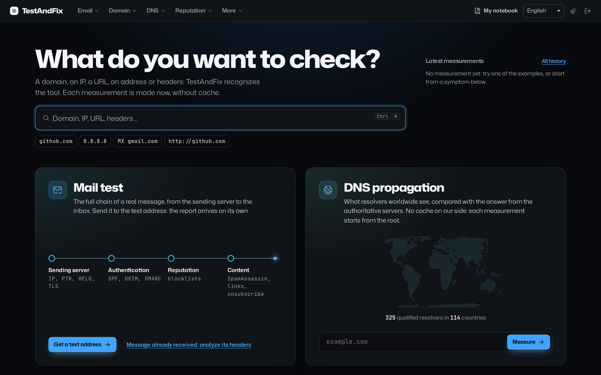
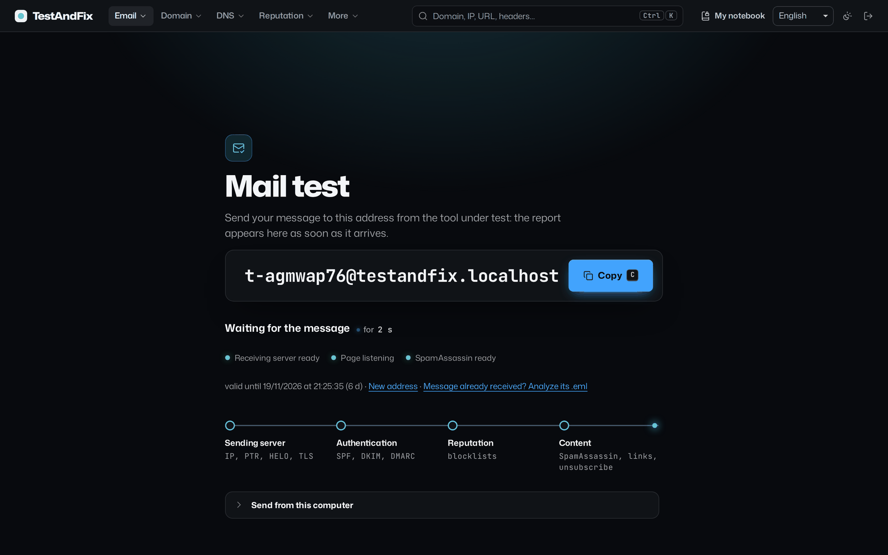
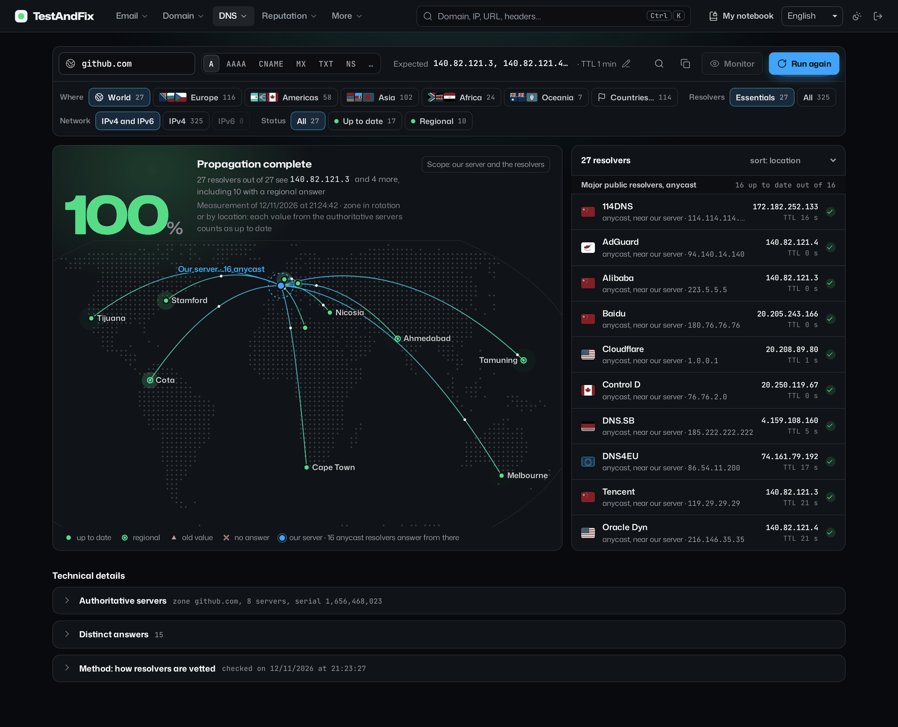
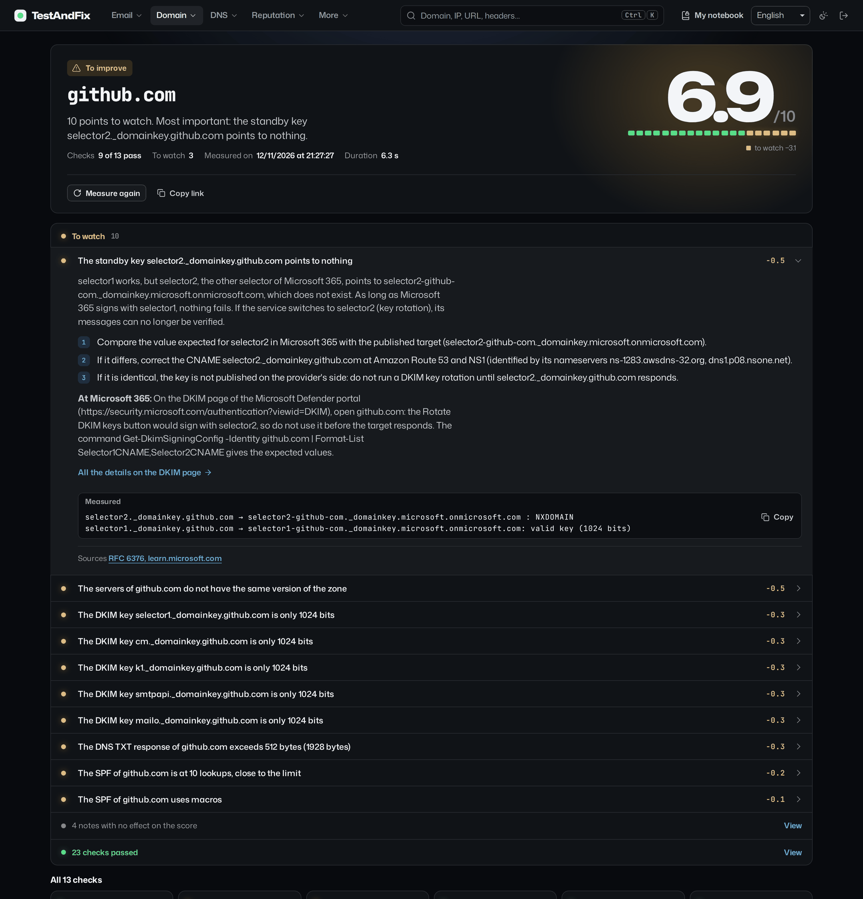
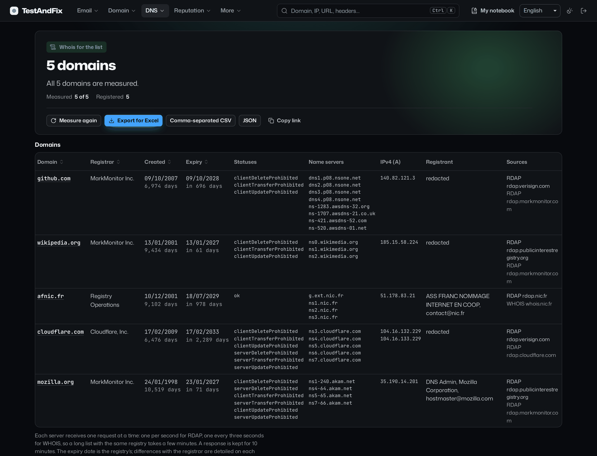
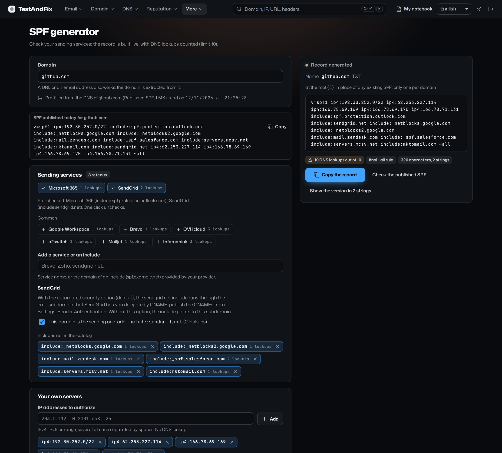
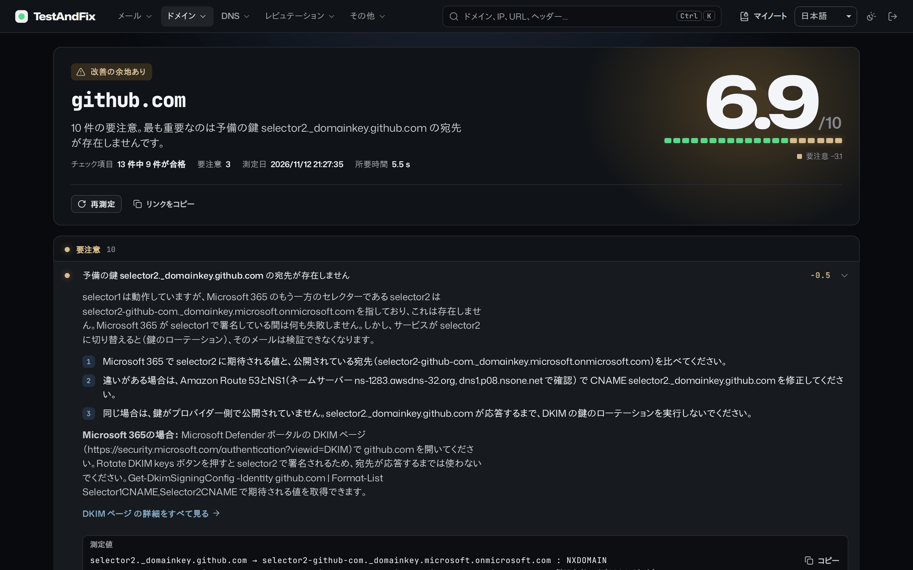
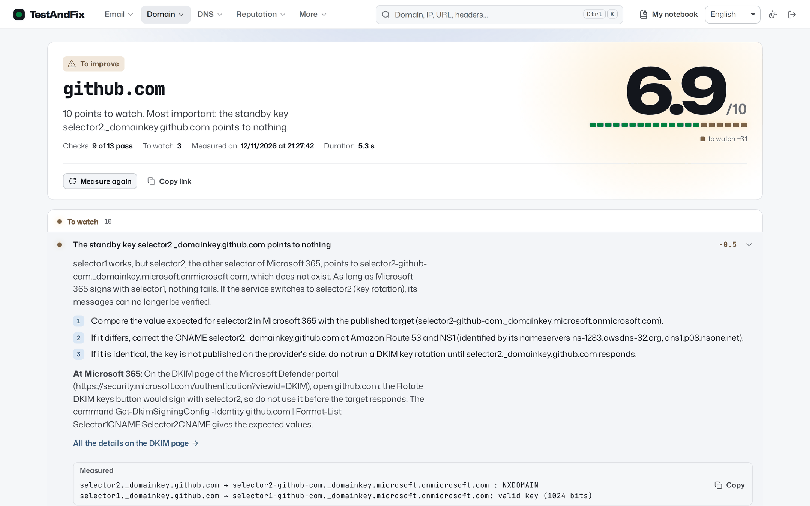

<div align="center">

# TestAndFix

**Test your email and your DNS like the best online checkers, then get the exact fix. On your own server.**

Mail test · DNS propagation · Domain scanner · Whois and RDAP · Reputation · Generators · DMARC reports

Self-hosted · MIT licence · Docker Compose · 6 languages · no account, no quota

English · [Français](README.fr.md)



</div>

## Why another checker?

Online checkers tell you **that** something is wrong. TestAndFix tells you **why**, **what it costs you** and
**what to paste where** to fix it, for your sending service.

- **A score is not a fix.** Every finding comes from a knowledge base of **949 diagnosed situations**, each with
  the reason in plain words, the correction ready to copy, and step-by-step instructions for **24 sending
  services and hosts** (Google Workspace, Microsoft 365, Brevo, Mailchimp, SendGrid, Amazon SES, Mailjet,
  Postmark, OVHcloud, cPanel, WordPress…). **528 SpamAssassin rules** are explained by name, with
  **1,461 references** to RFCs and provider documentation.
- **The score measures delivery.** A mail test score reflects what decides whether this message reaches the
  inbox; good-practice advice is listed separately and costs no point, so a repaired message scores 9 to 10.
- **Your tests stay yours.** No daily quota, no public result page reachable by anyone who guesses an address.
  Results belong to the browser that ran them; you share a report only when you create a link.
- **Measured live, from the source.** DNS answers are resolved from the root, without cache, and compared
  with the authoritative servers. Resolvers used for propagation are re-qualified every day.
- **In your language.** English, Spanish, German, Japanese, French and Portuguese, detected from the browser:
  the interface, and every diagnosis and fix written by the server.

## The tools

### Mail test: send a real message, get the whole chain



Create a test address, send your newsletter or transactional email to it from the real tool, and the report
arrives live. TestAndFix runs its own SMTP server and checks the whole path:

- **Sending server:** IP, reverse DNS (PTR), HELO, TLS version and certificate.
- **Authentication:** SPF, DKIM (every signature, key size), DMARC alignment, ARC, BIMI.
- **Reputation:** IP and domains on the DNS blocklists that answer correctly today, plus optional sources
  (Google Safe Browsing, VirusTotal, URLhaus, AbuseIPDB) when you add a free key.
- **Content:** a real SpamAssassin, every rule explained; links followed; images; HTML and text parts;
  one-click unsubscribe (RFC 8058) and the Gmail and Yahoo bulk sender requirements.

Already received the message? Paste its headers or drop the `.eml`.

### DNS propagation: the resolvers, the map, the truth



- Each answer is compared with what the **authoritative servers** say right now, not with another resolver.
- Resolvers are **qualified every day**: answers checked, rewriting resolvers set aside, anycast networks
  flagged as such (they answer from the node closest to the server, and the map says so).
- Filter by continent, UN region, country, IPv4 or IPv6; keep a page open to **monitor** a change until it is
  everywhere; every resolver is listed with its IP, provider, location, answer and TTL.

### Domain scanner: everything that gets a domain's email delivered



One measurement for MX, SPF (include tree and the 10-lookup limit), DKIM selector discovery, DMARC, MTA-STS and
TLS-RPT, BIMI, DNSSEC, SMTP servers, blocklists and the domain's registration. A score out of 10, then each
finding with its explanation, its impact and the fix.

### The Fix loop: test, fix, then watch the fix land

Published a correction? Click **Monitor my fix** on the domain report. TestAndFix reads the records that matter
for email (MX, SPF, DKIM selectors, DMARC, MTA-STS, TLS-RPT, BIMI, CAA) straight from the authoritative servers
every 15 seconds, and runs the full scan again the moment they change. You then see what is fixed, what is
new, the score before and after, and until what time resolvers may still serve the old answer (its TTL), with
a link to follow the propagation.

### Whois and RDAP: registry and registrar, side by side



The registry and the registrar can disagree: TestAndFix asks both (RDAP first, WHOIS port 43 as a fallback)
and shows the differences. Dates, EPP statuses explained, registrar, reseller, contacts when they are not
redacted, name servers, DNSSEC, IPv4 addresses. Up to 100 domains at once, exported to CSV (Excel ready) or
JSON. Queries are paced per server so that nobody gets blocked.

### And also

| Tool | What it does |
|---|---|
| SPF, DKIM, DMARC, BIMI, MTA-STS, SMTP | One check per standard, each tag explained, the corrected record ready to copy |
| DNS lookup | Authoritative answers, the resolution trace, `dig` format |
| DNSSEC | The chain of trust, from the parent zone to yours |
| Subdomains | Names revealed by Certificate Transparency, where they point now, takeover risks |
| Reputation | An IP or a domain against blocklists and security sources |
| Check a link | Redirects followed live from the server, phishing and malware sources |
| Redirects | Every hop: status, headers, body, timing, certificate, `curl` command |
| DMARC reports | Drop your aggregate reports: who sends in your name, who fails |
| Generators | SPF with a live lookup counter, DKIM keys generated in your browser (the private key never leaves it), a gradual DMARC plan, MTA-STS |
| Clear caches | DNS caches and the page cache, on the server and on your own machine (small optional agent) |



## How it compares

Facts taken from each service's own site on 2026-11-12.

| | TestAndFix | mail-tester.com |
|---|---|---|
| Free tests | Unlimited, it runs on your server | "You can perform 3 tests for free within the last 24 hours" ([FAQ](https://www.mail-tester.com/faq)) |
| Who can read a result | The browser that ran it, and the people you send a share link to | "All results are visible to anyone who has the exact testing address" ([FAQ](https://www.mail-tester.com/faq)) |
| How long results are kept | You decide (90 days by default) | "7 days with our free version or 30 days if you created an account" ([FAQ](https://www.mail-tester.com/faq)) |
| Fix instructions | The record to paste and the steps for your sending service | |
| Self-hosted, open source | Yes, MIT | Not stated |

| | TestAndFix | dnschecker.org | whatsmydns.net |
|---|---|---|---|
| Resolvers | 325 qualified in 114 countries on a fresh install, re-qualified daily, each one listed | "a comprehensive list of 100+ global DNS servers" ([home](https://dnschecker.org/)) | "DNS servers located in many countries" ([home](https://www.whatsmydns.net/)) |
| Reference | The authoritative servers, queried live | Not stated | Not stated |
| Self-hosted, open source | Yes, MIT | Not stated | Not stated |

## Quick start

You need a Linux machine with **Docker** and **Docker Compose v2**. Then:

```sh
git clone https://github.com/coeurduweb/TestAndFix.git
cd TestAndFix
cp .env.example .env
```

Open `.env` and set a password (the checking tools are behind it; the generators stay public):

```sh
TESTANDFIX_PASSWORD=choose-a-long-password
```

Start it:

```sh
docker compose up -d --build
```

Open **http://localhost:3000** and log in. That's it: the domain, DNS, Whois, reputation and generator tools
work right away. The first start also qualifies the propagation resolvers in the background (a few minutes).

<details>
<summary><b>Receive real test emails (mail test)</b></summary>

The mail test needs the world to be able to send mail to your server:

1. Choose a subdomain for test addresses, for example `test.example.com`, and set it in `.env`:
   `TESTANDFIX_MAIL_DOMAIN=test.example.com`
2. In your DNS, point that name to your server: an `A` record (and `AAAA` if you have IPv6), plus
   `MX 10 test.example.com.` on the same name.
3. Open **port 25** (TCP) on the server and its firewall. TestAndFix listens on it through Docker
   (`TESTANDFIX_SMTP_BIND`, default `0.0.0.0:25`).
4. For TLS (recommended: senders such as Gmail prefer it), give a certificate for that name:
   `TESTANDFIX_SMTP_TLS_CERT` and `TESTANDFIX_SMTP_TLS_KEY` (paths inside the container; mount them as a volume).
5. Restart: `docker compose up -d`.

Already running a mail server on port 25? Let it relay only that subdomain to TestAndFix and set
`TESTANDFIX_SMTP_TRUSTED_RELAYS` so the report shows the original sender (XFORWARD). Without port 25 at all,
TestAndFix can read a catch-all mailbox over IMAP (`TESTANDFIX_IMAP_*`).

</details>

<details>
<summary><b>Put it on a domain with HTTPS</b></summary>

TestAndFix listens on `127.0.0.1:3000` by default (`TESTANDFIX_HTTP_BIND`). Put your usual reverse proxy in
front. With nginx, keep buffering off for the live streams:

```nginx
location / {
    proxy_pass http://127.0.0.1:3000;
    proxy_set_header Host $host;
    proxy_set_header X-Forwarded-For $proxy_add_x_forwarded_for;
    proxy_set_header X-Forwarded-Proto $scheme;
    proxy_buffering off;
    proxy_read_timeout 300s;
}
```

Then set `TESTANDFIX_PUBLIC_URL=https://your.domain` in `.env`.

</details>

<details>
<summary><b>Production password, API keys, backups, updates</b></summary>

- **Password hash** instead of a plain password:
  `docker compose run --rm app node dist/hash-password.js 'your password'`, then put the result in `.env`
  between **single quotes** (it contains `$`, which Compose would otherwise expand):
  `TESTANDFIX_PASSWORD_HASH='scrypt$…'`.
- **Optional free API keys** (a missing key is shown in the report, never blocking): `GSB_API_KEY`
  (Google Safe Browsing), `VT_API_KEY` (VirusTotal), `ABUSEIPDB_API_KEY`, `URLHAUS_AUTH_KEY`.
- **Backups:** a copy of the database is made every day in the data volume (`/data/backups`, 14 kept).
- **Retention:** measurements are deleted after `TESTANDFIX_RETENTION_DAYS` (90 by default).
- **Update:** `git pull && docker compose up -d --build`.

Every setting is listed, with a comment, in [`.env.example`](.env.example).

</details>

## Privacy

- One password protects the instance; there are no user accounts. Each browser keeps its own **notebook**:
  its history, its test addresses and its reports, invisible to the other browsers. Two devices can be linked
  with a short one-time code.
- The application's logs record the route and the status, **never** the domains, IPs, URLs or addresses
  checked.
- Results are deleted after the retention period; a share link can be revoked at any time.

## Under the hood

Node.js 22, TypeScript, Fastify, SQLite (better-sqlite3), React 19 and Vite; a SpamAssassin container with its
own uncached resolver; an iterative DNS resolver of its own, starting from the root. Covered by
**491 server tests, 211 interface tests and 143 end-to-end tests**, including automatic accessibility scans
(axe) in light and dark themes.

```sh
npm ci
npm run dev        # server on :3000, interface on :5173
npm test           # unit tests
npm run e2e        # end-to-end tests (Playwright)
```

Translations: [docs/I18N.md](docs/I18N.md). Architecture notes (in French): [docs/ARCHITECTURE.md](docs/ARCHITECTURE.md).

 

## Licence and credits

MIT, see [LICENSE](LICENSE). Third-party data and software: [NOTICE.md](NOTICE.md).

Made by **[Cœur du Web](https://coeurduweb.com)**.
